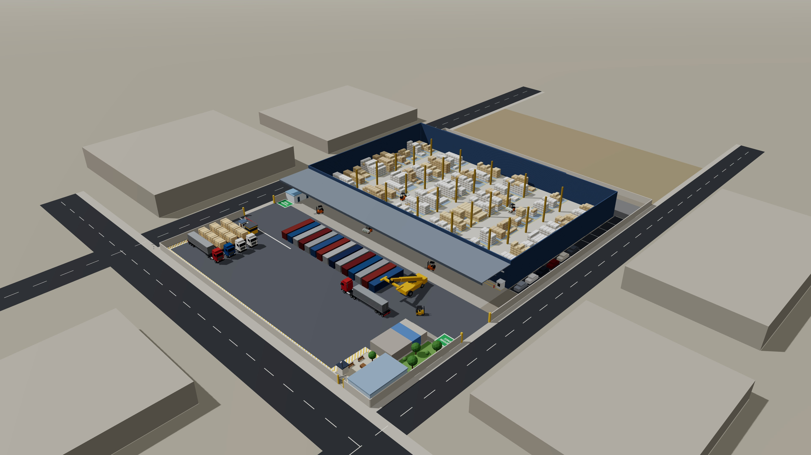

# Bodega Cervantes 3D

Modelo 3D interactivo de la bodega ubicada en Pedro Montt con Cervantes y Juan Macaya (terreno de 100 × 140 m, 14.000 m²).

Es una sola página web (`index.html`), sin instalación ni compilación. Usa [three.js](https://threejs.org/) 0.160.0, que se carga desde jsDelivr.

## Cómo verlo

- **En línea:** https://alejomorales360-dev.github.io/bodega-cervantes-3d/ (se publica solo con cada cambio en `main`).
- **En tu computador:** abre `index.html` en el navegador. Necesita internet para cargar three.js y las fuentes.

## Imágenes

Renders en 4K (3840 × 2160) en la carpeta `renders/`:

| Vista | Archivo |
|---|---|
| Isométrica general | `renders/1-isometrica.jpg` |
| Patio con contenedores y camiones | `renders/2-patio.jpg` |
| Interior con ubicaciones A–F | `renders/3-bodega.jpg` |
| Portones y alero | `renders/4-portones.jpg` |
| Oficinas, descanso y área verde | `renders/5-oficinas.jpg` |
| Bajo el alero (cerchas y portones) | `renders/6-alero.jpg` |
| Bodega pequeña y portones traseros | `renders/7-bodega-pequena.jpg` |
| Garita bajo el alero | `renders/8-garita-alero.jpg` |

Para generar capturas en alta resolución desde el navegador, abre la página con `#hd` al final de la dirección (sombras y resolución más altas).

## Qué incluye

- **Superficies según la planilla:** bodega principal (93,8 × 61,7 m), alero en voladizo (93,8 × 13,3 m), bodega pequeña (62,5 × 8 m), sector oficinas (15 × 30 m), estacionamiento (4,2 × 62,49 m), patio delantero (92 × 48 m) y patio trasero (100 × 13,3 m).
- **Según el plano "Layout def":**
  - Muros de acero corrugado azul, 5 portones correderos hacia el alero y 5 portones traseros (1 a 4 a la bodega pequeña, 5 al patio trasero).
  - 72 ubicaciones (A-1 a F-12) con paquetes de madera de 2,4 a 4,8 m.
  - Alero en voladizo sobre cerchas de acero, con una garita de guardias en la esquina del fondo.
  - Portones vehiculares a Cervantes y a Juan Macaya, y portón peatonal a Pedro Montt.
  - Gate control con caseta y garita de guardias.
  - Baños de conductores bajo el alero.
  - Oficina, camarines, pañol y camarín de mujeres.
  - Zona de descanso, garita de cámaras y área verde.
  - Sendero peatonal y zonas seguras junto a los portones.
  - Contenedores, camiones y grúa en el patio.
- **Vistas:** general, planta, frente, isométrica (sin techo, como maqueta) e interior. Se pueden mostrar u ocultar el techo, las etiquetas, las cotas, las ubicaciones y los vehículos.
- **Búsqueda de ubicaciones:** escribes un código (por ejemplo `C-7`) o lo tocas en el minimapa, y el modelo te lleva hasta esa ubicación.

## Supuestos pendientes de confirmar

- Alturas: bodega de 10 m al alero y 12,5 m en la cumbrera, y alero a 8 m.
- Tamaños de la garita, los baños, la garita de cámaras y las zonas seguras.
- Uso de la caseta blanca del patio trasero.
- A lo largo, las zonas suman 136,3 m, frente a los 140 m de Cervantes.

## Cómo editar

Todo está en `index.html`:

- **Medidas y posiciones:** en el objeto `R`. Las coordenadas están en metros: `x` va desde Cervantes hacia Juan Macaya y `z` desde Pedro Montt hacia el fondo.
- **Textos de cada zona:** en `ZONES`.
- **Ubicaciones A–F:** en `COLS` y `ROWS`.
